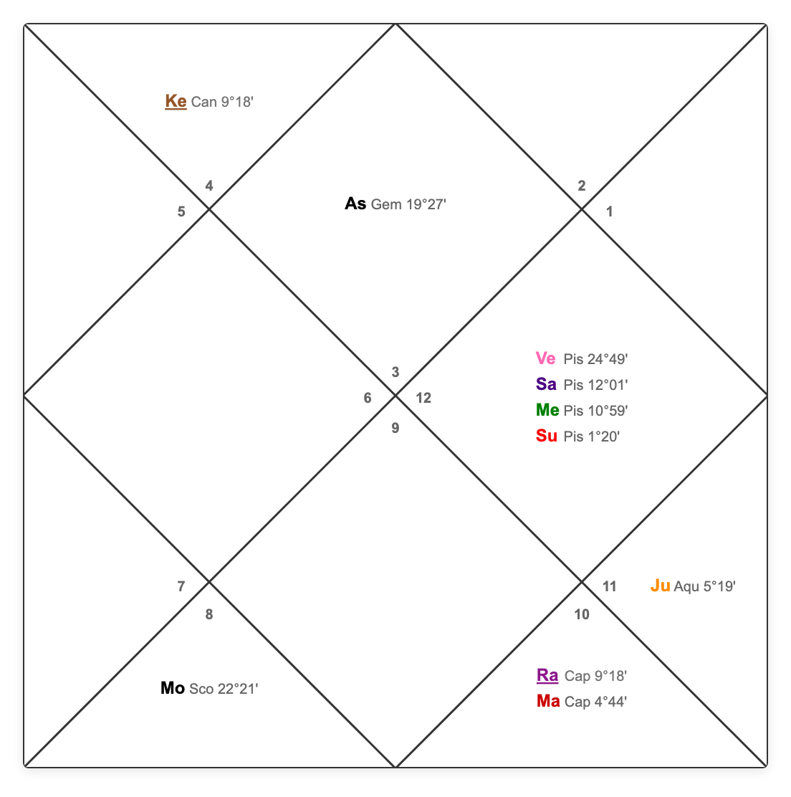
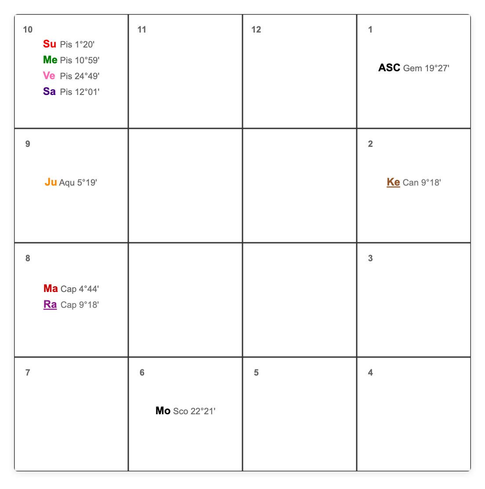
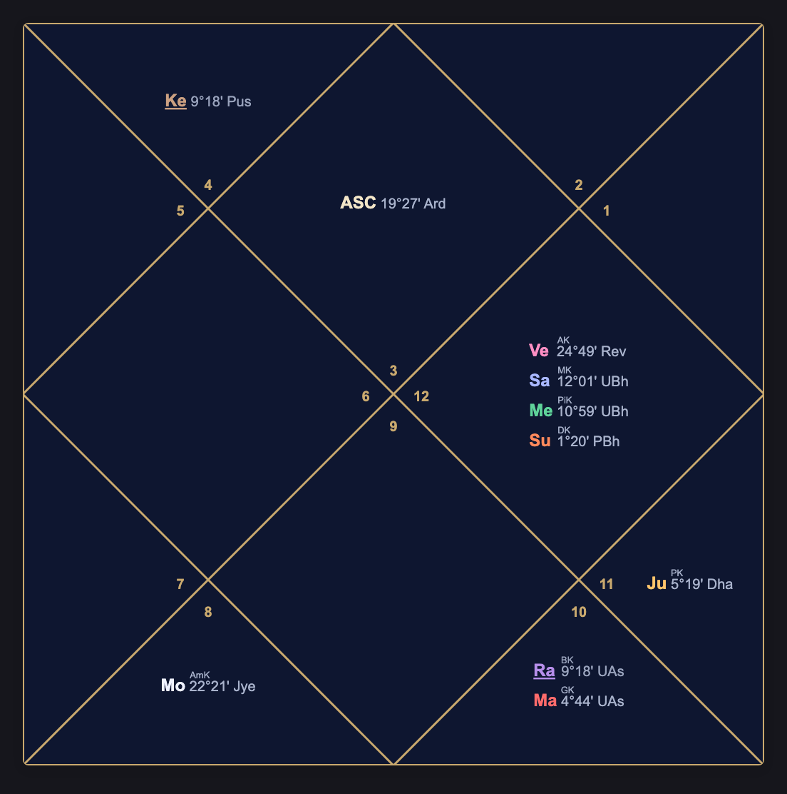
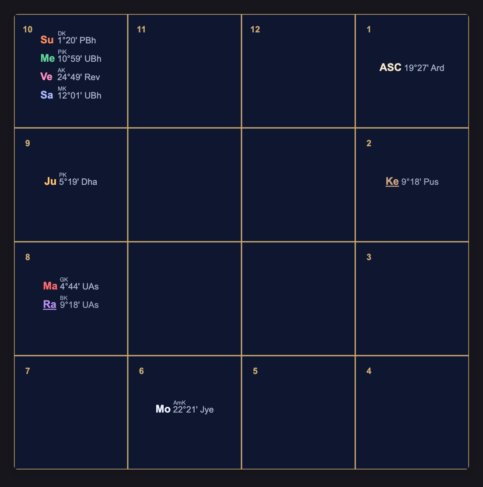
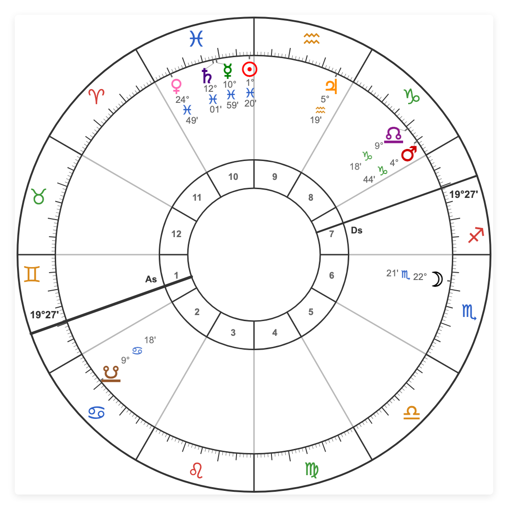
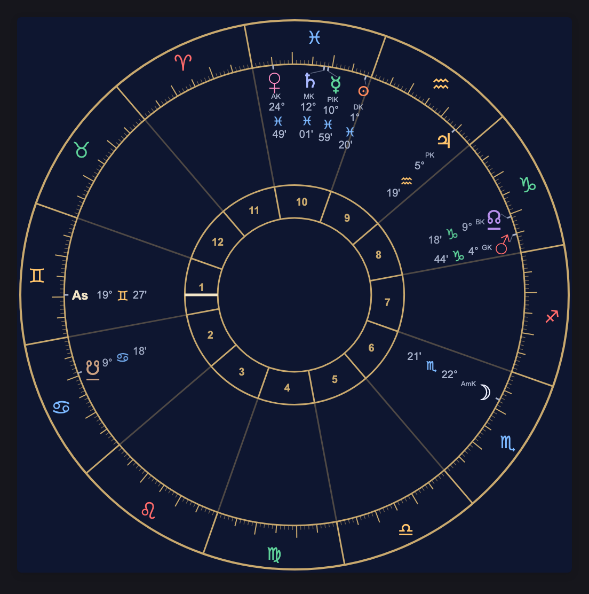

# Vedic Astrology Chart - SolidJS

> **See it in action:** this component draws the charts in [**jyotish-rs**](https://jyotish-rs.netlify.app/), a free Vedic astrology desktop app. → [jyotish-rs.netlify.app](https://jyotish-rs.netlify.app/)

## Overview

A beautiful SolidJS component for rendering Vedic (Jyotish) astrology charts. Supports both North Indian and South Indian chart formats with accurate whole sign house system calculations.

## Features

- **Dual Chart Formats**: North Indian (diamond) and South Indian (grid) styles
- **Whole Sign System**: Accurate Vedic astrology house calculations
- **Flexible Planet Display**: Choose between traditional astronomical symbols or abbreviated names
- **Sidereal Positions**: Works with sidereal planetary positions
- **Ascendant Display**: Shows ascendant with exact degrees in both chart formats
- **Smart Stacking**: Automatic vertical stacking when multiple planets occupy the same house
- **Rahu-Ketu Synchronization**: Ensures North and South nodes are exactly 180° apart
- **Dynamic House Labels**: Shows zodiac sign numbers (1-12) based on ascendant position
- **Customizable**: Adjustable dimensions, house numbers, zodiac labels
- **TypeScript**: Full type safety and IntelliSense support
- **Reactive**: Built with SolidJS for optimal performance and fine-grained reactivity

## Installation

```bash
npm install vedic-astrology-chart-solid solid-js @solidjs/web
# or
bun add vedic-astrology-chart-solid solid-js @solidjs/web
# or
yarn add vedic-astrology-chart-solid solid-js @solidjs/web
```

Version 2 targets **Solid 2** (`solid-js` and `@solidjs/web` 2.x). For Solid
1.x, use version 1 (`npm install vedic-astrology-chart-solid@1`).

### Include Styles (Optional)

```tsx
// Import the component
import { VedicChart } from 'vedic-astrology-chart-solid';

// Option 1: Import CSS file (if your bundler supports it)
import 'vedic-astrology-chart-solid/styles';

// Option 2: Use the CSS string export
import { VedicChart, defaultStyles } from 'vedic-astrology-chart-solid';

function MyApp() {
  return (
    <>
      <style>{defaultStyles}</style>
      <VedicChart {...chartData} />
    </>
  );
}
```

## Quick Start

```tsx
import { VedicChart } from 'vedic-astrology-chart-solid';

function MyChart() {
  const birthChart = {
    planets: {
      Sun: 95.5, // Sidereal positions in degrees
      Moon: 145.2,
      Mars: 310.7,
      Mercury: 108.8,
      Jupiter: 85.2,
      Venus: 200.3,
      Saturn: 270.5,
      Rahu: 42.3, // North Node
      Ketu: 222.3, // South Node (automatically synchronized to be 180° from Rahu)
    },
    ascendant: 15.5, // Sidereal ascendant in degrees
  };

  return (
    <VedicChart
      {...birthChart}
      style="north" // or "south" or "circle"
      width={600}
      height={600}
      showHouseLabels={true}
      planetDisplayMode="symbols" // or "names"
    />
  );
}
```

## Example Charts

Albert Einstein's chart (14 March 1879, 11:30 LMT, Ulm; Lahiri ayanamsa).

| North Indian | South Indian |
| --- | --- |
|  |  |

With `details` (degree and nakshatra), `tags` (chara karakas) and `ascendantDetails`, themed
through the stylesheet's classes (the dark palette from the jyotish-rs app):

| North Indian | South Indian |
| --- | --- |
|  |  |

The circular wheel (`style="circle"`): the ascendant at 9 o'clock, signs running
counterclockwise, whole-sign houses, and each body at its exact degree (spread apart where
they crowd, with a pointer to the true position). `planetDisplayMode` switches planet and
sign glyphs for two- and three-letter names.

| Symbols | Dark palette, with karaka tags |
| --- | --- |
|  |  |

## API Reference

### VedicChart Props

| Prop                | Type                   | Default      | Description                                     |
| ------------------- | ---------------------- | ------------ | ----------------------------------------------- |
| `planets`           | `PlanetaryPositions`   | **required** | Sidereal planetary positions in degrees (0-360) |
| `ascendant`         | `number`               | **required** | Sidereal ascendant position in degrees          |
| `ayanamsa`          | `number`               | optional     | Ayanamsa value (informational only)             |
| `style`             | `'north' \| 'south' \| 'circle'` | `'north'` | Chart style: North or South Indian, or a circular Western-style wheel |
| `width`             | `number`               | `600`        | SVG width in pixels                             |
| `height`            | `number`               | `600`        | SVG height in pixels                            |
| `showHouseLabels`   | `boolean`              | `true`       | Show zodiac sign numbers in houses              |
| `planetDisplayMode` | `'symbols' \| 'names'` | `'symbols'`  | How to display planets                          |
| `allowKetuOverride` | `boolean`              | `false`      | Allow manual Ketu positioning                   |
| `rowSpacing`        | `number`               | `1`          | Scale for the gap between label rows in a house |

### Planet Positions Interface

```tsx
interface PlanetaryPositions {
  Sun: number;
  Moon: number;
  Mars: number;
  Mercury: number;
  Jupiter: number;
  Venus: number;
  Saturn: number;
  Rahu: number; // North Node
  Ketu: number; // South Node (auto-calculated if allowKetuOverride is false)
}
```

## Advanced Usage

### Interactive Chart with Controls

```tsx
import { createSignal } from 'solid-js';
import { VedicChart } from 'vedic-astrology-chart-solid';
import type {
  ChartStyle,
  PlanetDisplayMode,
} from 'vedic-astrology-chart-solid/types';

function InteractiveChart() {
  const [style, setStyle] = createSignal<ChartStyle>('north');
  const [planetDisplayMode, setPlanetDisplayMode] =
    createSignal<PlanetDisplayMode>('symbols');
  const [showHouseLabels, setShowHouseLabels] = createSignal(true);

  const birthChart = {
    planets: {
      Sun: 95.5,
      Moon: 145.2,
      Mars: 310.7,
      Mercury: 108.8,
      Jupiter: 85.2,
      Venus: 200.3,
      Saturn: 270.5,
      Rahu: 42.3,
      Ketu: 222.3,
    },
    ascendant: 15.5,
  };

  return (
    <div>
      <div style={{ 'margin-bottom': '20px' }}>
        <button onClick={() => setStyle('north')}>North Indian</button>
        <button onClick={() => setStyle('south')}>South Indian</button>
        <button
          onClick={() =>
            setPlanetDisplayMode(
              planetDisplayMode() === 'symbols' ? 'names' : 'symbols'
            )
          }
        >
          Toggle Planet Display
        </button>
        <button onClick={() => setShowHouseLabels(!showHouseLabels())}>
          Toggle House Labels
        </button>
      </div>

      <VedicChart
        {...birthChart}
        style={style()}
        planetDisplayMode={planetDisplayMode()}
        showHouseLabels={showHouseLabels()}
        width={600}
        height={600}
      />
    </div>
  );
}
```

### Custom Planet Colors and Styling

The component uses built-in colors for planets, but you can override styles by targeting the SVG elements:

```css
.vedic-chart svg text {
  font-family: 'Arial', sans-serif;
}

.vedic-chart svg tspan[fill='#FF6B35'] {
  fill: #ff0000; /* Custom Sun color */
}

/* Chart structure - more specific classes */
.vedic-chart .chart-lines {
  stroke: #333333;
  stroke-width: 1.5;
  fill: none;
}

.vedic-chart .chart-border {
  stroke: #333333;
  stroke-width: 2;
  fill: none;
}

/* Specific line types for more control */
.vedic-chart .diamond-lines {
  stroke: inherit;
  stroke-width: inherit;
}

.vedic-chart .diagonal-lines {
  stroke: inherit;
  stroke-width: inherit;
}
```

## Planet Display Modes

### Symbols Mode (`planetDisplayMode="symbols"`)

- Sun: ☉
- Moon: ☽
- Mars: ♂
- Mercury: ☿
- Jupiter: ♃
- Venus: ♀
- Saturn: ♄
- Rahu: ☊
- Ketu: ☋

### Names Mode (`planetDisplayMode="names"`)

- Sun: Su
- Moon: Mo
- Mars: Ma
- Mercury: Me
- Jupiter: Ju
- Venus: Ve
- Saturn: Sa
- Rahu: Ra
- Ketu: Ke

## Chart Styles

### North Indian Style

- Diamond-shaped layout
- Traditional North Indian format
- Houses arranged in diamond pattern
- Ascendant always at the top

### South Indian Style

- Grid-based layout (3x3 with center removed)
- Traditional South Indian format
- Fixed house positions
- Leo always in the top-left corner

## Styling and Customization

### Include Default Styles

```tsx
import { VedicChart } from 'vedic-astrology-chart-solid';
import 'vedic-astrology-chart-solid/styles';

function MyChart() {
  return <VedicChart {...chartData} />;
}
```

### Using the CSS String Export

```tsx
import { VedicChart, defaultStyles } from 'vedic-astrology-chart-solid';

function MyChart() {
  return (
    <>
      <style>{defaultStyles}</style>
      <VedicChart {...chartData} />
    </>
  );
}
```

### Custom Styling

You can customize the appearance using CSS classes:

```css
/* Override planet colors */
.vedic-chart .planet-sun {
  fill: #ff4444;
}
.vedic-chart .planet-jupiter {
  fill: #44ff44;
}
.vedic-chart .planet-moon {
  fill: #2196f3;
}

/* Customize chart appearance */
.vedic-chart svg {
  background-color: #f5f5f5;
  border-radius: 8px;
  border: 2px solid #ddd;
}

/* Change font sizes */
.vedic-chart .planet-text {
  font-size: 16px;
  font-weight: 600;
}

.vedic-chart .house-label {
  font-size: 14px;
  fill: #333;
}

/* Customize chart lines */
.vedic-chart .chart-border {
  stroke: #666;
  stroke-width: 3;
}

.vedic-chart .chart-lines {
  stroke: #999;
  stroke-width: 2;
}
```

### Dark Theme

```tsx
<VedicChart {...chartData} theme="dark-theme" />
```

Or apply dark theme styles manually:

```css
/* Dark theme customization */
.my-dark-chart svg {
  background-color: #1a1a1a;
}

.my-dark-chart .house-label {
  fill: #cccccc;
}

.my-dark-chart .chart-lines,
.my-dark-chart .chart-border {
  stroke: #666666;
}

.my-dark-chart .planet-details {
  fill: #aaaaaa;
}
```

### Available CSS Classes

| Class              | Description                                              |
| ------------------ | -------------------------------------------------------- |
| `.vedic-chart`     | Main container wrapper                                   |
| `.vedic-chart-svg` | SVG element                                              |
| `.planet-text`     | Planet symbols/names                                     |
| `.planet-symbol`   | Individual planet symbol                                 |
| `.planet-details`  | Planet degrees and signs                                 |
| `.house-label`     | Zodiac sign numbers                                      |
| `.ascendant-text`  | Ascendant marker text                                    |
| `.chart-lines`     | Chart structure lines                                    |
| `.chart-border`    | Outer border                                             |
| `.planet-[name]`   | Individual planets (e.g., `.planet-sun`, `.planet-mars`) |

### Planet-Specific Classes

Target individual planets with these classes:

```css
.vedic-chart .planet-sun {
  fill: #ff6b35;
} /* Sun */
.vedic-chart .planet-moon {
  fill: #1a1a2e;
} /* Moon */
.vedic-chart .planet-mars {
  fill: #dc3545;
} /* Mars */
.vedic-chart .planet-mercury {
  fill: #28a745;
} /* Mercury */
.vedic-chart .planet-jupiter {
  fill: #ffc107;
} /* Jupiter */
.vedic-chart .planet-venus {
  fill: #e91e63;
} /* Venus */
.vedic-chart .planet-saturn {
  fill: #6f42c1;
} /* Saturn */
.vedic-chart .planet-rahu {
  fill: #9c27b0;
} /* Rahu */
.vedic-chart .planet-ketu {
  fill: #8d6e63;
} /* Ketu */
```

### Responsive Design

The component includes responsive breakpoints. Customize them:

```css
@media (max-width: 768px) {
  .vedic-chart .planet-text {
    font-size: 12px;
  }

  .vedic-chart .planet-details {
    font-size: 10px;
  }

  .vedic-chart .house-label {
    font-size: 10px;
  }
}

@media (max-width: 480px) {
  .vedic-chart svg {
    border-radius: 4px;
  }

  .vedic-chart .planet-text {
    font-size: 10px;
  }
}
```

### CSS Custom Properties

For easy theming, you can use CSS variables:

```css
:root {
  --vedic-bg: #ffffff;
  --vedic-border: #333333;
  --vedic-text: #000000;
  --vedic-planet-sun: #ff0000;
  --vedic-planet-moon: #000000;
  /* ... more custom properties */
}

.vedic-chart svg {
  background-color: var(--vedic-bg);
}

.vedic-chart .chart-border {
  stroke: var(--vedic-border);
}

.vedic-chart .planet-sun {
  fill: var(--vedic-planet-sun);
}
```

### Advanced Styling Examples

#### Gradient Backgrounds

```css
.vedic-chart svg {
  background: linear-gradient(135deg, #667eea 0%, #764ba2 100%);
}
```

#### Custom Fonts

```css
.vedic-chart {
  font-family: 'Noto Sans Devanagari', 'Arial', sans-serif;
}
```

#### Shadow Effects

```css
.vedic-chart svg {
  filter: drop-shadow(0 4px 8px rgba(0, 0, 0, 0.2));
}
```

#### Animation

```css
.vedic-chart .planet-text {
  transition: transform 0.2s ease;
}

.vedic-chart .planet-text:hover {
  transform: scale(1.1);
}
```

## Development

To run the demo locally:

1. Clone the repository:

   ```bash
   git clone https://github.com/koa137/vedic-astrology-chart-solid.git
   cd vedic-astrology-chart-solid
   ```

2. Install dependencies:

   ```bash
   bun install
   # or npm install
   ```

3. Start the development server:

   ```bash
   bun run dev
   # or npm run dev
   ```

4. Open your browser and navigate to `http://localhost:3000`

### Building the Library

```bash
# Build for production
bun run build

# Run linting
bun run lint

# Format code
bun run format

# Type checking
bun run type-check
```

## Requirements

- **SolidJS**: `solid-js` ^2.0.0 and `@solidjs/web` ^2.0.0 (version 1 of this
  package supports Solid ^1.8)
- **TypeScript**: ^5.0.0 (for TypeScript projects)
- **Modern Browser**: Supports SVG rendering

## Browser Support

- Chrome/Edge: Latest 2 versions
- Firefox: Latest 2 versions
- Safari: Latest 2 versions
- iOS Safari: Latest 2 versions

## Contributing

1. Fork the repository
2. Create your feature branch (`git checkout -b feature/amazing-feature`)
3. Run tests and linting (`bun run lint && bun run type-check`)
4. Commit your changes (`git commit -m 'Add some amazing feature'`)
5. Push to the branch (`git push origin feature/amazing-feature`)
6. Open a Pull Request

## Roadmap

- [ ] Divisional charts (D2, D9, D10, etc.)
- [ ] Nakshatra displays
- [ ] Planetary aspects visualization
- [ ] Chart comparison tools
- [ ] Animation support for transits
- [ ] Dark mode support
- [ ] Export to PNG/SVG
- [ ] Custom color themes

## License

This project is licensed under the MIT License - see the [LICENSE](LICENSE) file for details.

## Acknowledgments

- Built with **SolidJS** for optimal performance and reactivity
- **TypeScript** for type safety and developer experience
- **SVG-based rendering** for crisp, scalable charts
- Follows traditional **Vedic astrology principles**
- Accurate **whole sign house system** implementation
- Inspired by classical Indian astronomical texts

## Support

If you encounter any issues or have questions:

1. Check the [Issues](https://github.com/koa137/vedic-astrology-chart-solid/issues) page
2. Create a new issue with detailed information
3. Join our [Discussions](https://github.com/koa137/vedic-astrology-chart-solid/discussions) for community help

---

**Note**: This library focuses on accurate Vedic astrology calculations using the sidereal zodiac and whole sign house system. For tropical astrology or other house systems, consider using a different library or adapting the calculations accordingly.
